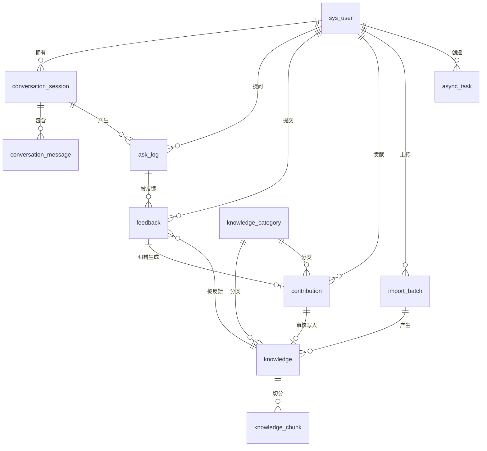

# CampusNexus 数据库建表文档

> **项目名称**：CampusNexus（校园生活百事通 / 校园知识库问答）
> **文档版本**：v1.0（2026-10-21）
> **文档状态**：数据库设计稿；Flyway V1/V2 脚本已生成
> **数据库**：MySQL 8.0 / 8.4
> **关联文档**：[接口文档](./接口文档.md)、[技术栈文档](./技术栈文档.md)、[项目具体框架文档](./项目具体框架文档.md)

---

## 1. 设计约定

| 项 | 约定 |
|----|------|
| 字符集 | `utf8mb4`，排序规则 `utf8mb4_0900_ai_ci` |
| 存储引擎 | InnoDB |
| 主键 | 业务表使用 `BIGINT AUTO_INCREMENT`；会话、批次、异步任务对外使用 UUID |
| 时间 | `DATETIME`，JVM/MySQL 时区统一 `Asia/Shanghai` |
| 逻辑删除 | `deleted TINYINT NOT NULL DEFAULT 0`，仅知识表使用 |
| 外键 | 不建物理外键，使用逻辑关联 + 索引，避免迁移与批量删除受限 |
| 金额/浮点 | 本期无金额字段 |
| JSON | MySQL `JSON` 类型，仅用于引用列表、任务参数等非检索字段 |
| 命名 | 表/字段 `snake_case`；索引 `idx_*`、唯一索引 `uk_*` |
| 迁移 | Flyway 管理，禁止手工修改生产库结构 |

---

## 2. ER 关系



---

## 3. 表清单

| # | 表名 | 用途 | 关键约束 |
|:-:|------|------|----------|
| 1 | `sys_user` | 用户与管理员 | `username` 唯一、`email` 可空唯一 |
| 2 | `knowledge_category` | 动态分类 | `name` 唯一 |
| 3 | `import_batch` | 文档导入批次 | 主键 `batch_id` UUID |
| 4 | `knowledge` | 知识条目 | 逻辑删除、`vector_status`、`import_batch_id` |
| 5 | `knowledge_chunk` | 知识分片与 Chroma ID 映射 | `(knowledge_id, chunk_index)` 唯一 |
| 6 | `conversation_session` | 会话 | `session_key` UUID 唯一 |
| 7 | `conversation_message` | 会话消息 | `(session_id, message_index)` 唯一 |
| 8 | `ask_log` | 提问日志 | `id` 即接口 `logId` |
| 9 | `feedback` | 反馈 | `(user_id, log_id, feedback_type)` 唯一 |
| 10 | `contribution` | 用户贡献 | 审核后写 `knowledge_id` |
| 11 | `async_task` | 向量化/回滚异步任务 | 主键 `task_id` UUID |

---

## 4. 完整 DDL

### 4.1 用户表 `sys_user`

```sql
CREATE TABLE sys_user (
    id            BIGINT       NOT NULL AUTO_INCREMENT COMMENT '用户ID',
    username      VARCHAR(20)  NOT NULL COMMENT '用户名',
    password_hash VARCHAR(100) NOT NULL COMMENT 'BCrypt 密码哈希',
    email         VARCHAR(100) NULL COMMENT '邮箱',
    avatar        VARCHAR(512) NULL COMMENT '头像URL',
    phone         VARCHAR(20)  NULL COMMENT '手机号',
    role          TINYINT      NOT NULL DEFAULT 0 COMMENT '0=普通用户,1=管理员',
    status        TINYINT      NOT NULL DEFAULT 1 COMMENT '0=禁用,1=正常',
    token_version INT          NOT NULL DEFAULT 0 COMMENT 'Token版本号，改密/禁用/改角色时+1',
    create_time   DATETIME     NOT NULL DEFAULT CURRENT_TIMESTAMP COMMENT '创建时间',
    update_time   DATETIME     NOT NULL DEFAULT CURRENT_TIMESTAMP ON UPDATE CURRENT_TIMESTAMP COMMENT '更新时间',
    PRIMARY KEY (id),
    UNIQUE KEY uk_user_username (username),
    UNIQUE KEY uk_user_email (email),
    KEY idx_user_status_role (status, role)
) ENGINE = InnoDB
  DEFAULT CHARSET = utf8mb4
  COLLATE = utf8mb4_0900_ai_ci
  COMMENT = '用户表';
```

> MySQL 唯一索引允许多个 `NULL`，因此 `email` 可空唯一。空字符串应在应用层转为 `NULL`，避免多个空串冲突。

### 4.2 分类表 `knowledge_category`

```sql
CREATE TABLE knowledge_category (
    id          BIGINT      NOT NULL AUTO_INCREMENT COMMENT '分类ID',
    name        VARCHAR(32) NOT NULL COMMENT '分类名称',
    sort        INT         NOT NULL DEFAULT 0 COMMENT '排序值，越小越靠前',
    status      TINYINT     NOT NULL DEFAULT 1 COMMENT '0=停用,1=启用',
    create_time DATETIME    NOT NULL DEFAULT CURRENT_TIMESTAMP COMMENT '创建时间',
    update_time DATETIME    NOT NULL DEFAULT CURRENT_TIMESTAMP ON UPDATE CURRENT_TIMESTAMP COMMENT '更新时间',
    PRIMARY KEY (id),
    UNIQUE KEY uk_category_name (name),
    KEY idx_category_status_sort (status, sort)
) ENGINE = InnoDB
  DEFAULT CHARSET = utf8mb4
  COLLATE = utf8mb4_0900_ai_ci
  COMMENT = '知识分类表';
```

### 4.3 导入批次表 `import_batch`

```sql
CREATE TABLE import_batch (
    batch_id          CHAR(36)     NOT NULL COMMENT '批次UUID',
    file_url          VARCHAR(512) NOT NULL COMMENT 'OSS文件URL',
    original_filename VARCHAR(255) NOT NULL COMMENT '原始文件名',
    file_type         VARCHAR(32)  NOT NULL COMMENT '文件类型',
    category_id       BIGINT       NOT NULL COMMENT '分类ID',
    keywords          VARCHAR(500) NULL COMMENT '补充关键词',
    knowledge_count   INT          NOT NULL DEFAULT 0 COMMENT '生成知识数',
    total_chars       INT          NOT NULL DEFAULT 0 COMMENT '文档总字符数',
    status            VARCHAR(16)  NOT NULL COMMENT 'SUCCESS/FAILED/ROLLED_BACK',
    error_message     VARCHAR(1000) NULL COMMENT '失败原因',
    created_by        BIGINT       NOT NULL COMMENT '上传管理员ID',
    create_time       DATETIME     NOT NULL DEFAULT CURRENT_TIMESTAMP COMMENT '上传时间',
    update_time       DATETIME     NOT NULL DEFAULT CURRENT_TIMESTAMP ON UPDATE CURRENT_TIMESTAMP COMMENT '更新时间',
    rolled_back_by    BIGINT       NULL COMMENT '回滚操作人',
    rolled_back_time  DATETIME     NULL COMMENT '回滚时间',
    PRIMARY KEY (batch_id),
    KEY idx_batch_status_time (status, create_time),
    KEY idx_batch_category (category_id)
) ENGINE = InnoDB
  DEFAULT CHARSET = utf8mb4
  COLLATE = utf8mb4_0900_ai_ci
  COMMENT = '文档导入批次表';
```

### 4.4 知识表 `knowledge`

```sql
CREATE TABLE knowledge (
    id                BIGINT       NOT NULL AUTO_INCREMENT COMMENT '知识ID',
    category_id       BIGINT       NOT NULL COMMENT '分类ID',
    title             VARCHAR(200) NULL COMMENT '标题',
    question          VARCHAR(500) NULL COMMENT '标准问题',
    answer            TEXT         NULL COMMENT '标准答案',
    keywords          VARCHAR(500) NULL COMMENT '关键词，逗号分隔',
    view_count        INT          NOT NULL DEFAULT 0 COMMENT '浏览次数',
    status            TINYINT      NOT NULL DEFAULT 1 COMMENT '0=下架,1=正常',
    source_type       VARCHAR(16)  NOT NULL DEFAULT 'manual' COMMENT 'manual/upload',
    file_url          VARCHAR(512) NULL COMMENT 'OSS原始文件URL',
    original_filename VARCHAR(255) NULL COMMENT '原始文件名',
    file_type         VARCHAR(32)  NULL COMMENT '文件类型',
    vector_status     TINYINT      NOT NULL DEFAULT 0 COMMENT '0=待同步,1=已同步,2=失败',
    vector_error      VARCHAR(500) NULL COMMENT '最近向量化失败原因',
    vector_synced_time DATETIME    NULL COMMENT '最近同步成功时间',
    import_batch_id   CHAR(36)     NULL COMMENT '上传批次UUID，手动录入为NULL',
    created_by        BIGINT       NULL COMMENT '创建管理员ID',
    create_time       DATETIME     NOT NULL DEFAULT CURRENT_TIMESTAMP COMMENT '创建时间',
    update_time       DATETIME     NOT NULL DEFAULT CURRENT_TIMESTAMP ON UPDATE CURRENT_TIMESTAMP COMMENT '更新时间',
    deleted           TINYINT      NOT NULL DEFAULT 0 COMMENT '0=未删除,1=已删除',
    PRIMARY KEY (id),
    KEY idx_knowledge_public (status, category_id, create_time),
    KEY idx_knowledge_vector (status, vector_status),
    KEY idx_knowledge_batch (import_batch_id),
    KEY idx_knowledge_deleted (deleted)
) ENGINE = InnoDB
  DEFAULT CHARSET = utf8mb4
  COLLATE = utf8mb4_0900_ai_ci
  COMMENT = '知识条目表';
```

> `title/question/answer` 至少一项非空、`question` 与 `answer` 成对，由应用层校验；数据库不建 CHECK，便于后续扩展。
> 公共搜索只返回 `status=1 AND deleted=0`；RAG 向量检索只使用 `status=1 AND vector_status=1 AND deleted=0`。

### 4.5 知识分片表 `knowledge_chunk`

```sql
CREATE TABLE knowledge_chunk (
    id              BIGINT       NOT NULL AUTO_INCREMENT COMMENT '分片ID',
    knowledge_id    BIGINT       NOT NULL COMMENT '知识ID',
    chunk_index     INT          NOT NULL COMMENT '分片序号，从0开始',
    chroma_id       VARCHAR(128) NOT NULL COMMENT 'Chroma向量ID',
    content         TEXT         NOT NULL COMMENT '分片文本',
    embedding_model VARCHAR(64)  NULL COMMENT 'Embedding模型',
    create_time     DATETIME     NOT NULL DEFAULT CURRENT_TIMESTAMP COMMENT '创建时间',
    PRIMARY KEY (id),
    UNIQUE KEY uk_chunk_knowledge_index (knowledge_id, chunk_index),
    KEY idx_chunk_chroma (chroma_id)
) ENGINE = InnoDB
  DEFAULT CHARSET = utf8mb4
  COLLATE = utf8mb4_0900_ai_ci
  COMMENT = '知识分片与向量ID映射表';
```

> 该表用于可靠删除/回滚：Chroma 删除可按 `chroma_id` 精确执行；也便于重建向量时定位分片。若 MVP 简化，可暂不建表，改用 Chroma metadata 中的 `knowledgeId/importBatchId` 过滤删除。

### 4.6 会话表 `conversation_session`

```sql
CREATE TABLE conversation_session (
    id            BIGINT      NOT NULL AUTO_INCREMENT COMMENT '内部会话ID',
    session_key   CHAR(36)    NOT NULL COMMENT '对外会话UUID',
    user_id       BIGINT      NULL COMMENT '所属用户ID，匿名会话为NULL',
    title         VARCHAR(100) NOT NULL COMMENT '会话标题',
    message_count INT         NOT NULL DEFAULT 0 COMMENT '消息数量',
    start_time    DATETIME    NOT NULL DEFAULT CURRENT_TIMESTAMP COMMENT '开始时间',
    end_time      DATETIME    NULL COMMENT '结束时间',
    create_time   DATETIME    NOT NULL DEFAULT CURRENT_TIMESTAMP COMMENT '创建时间',
    update_time   DATETIME    NOT NULL DEFAULT CURRENT_TIMESTAMP ON UPDATE CURRENT_TIMESTAMP COMMENT '更新时间',
    PRIMARY KEY (id),
    UNIQUE KEY uk_session_key (session_key),
    KEY idx_session_user_time (user_id, start_time)
) ENGINE = InnoDB
  DEFAULT CHARSET = utf8mb4
  COLLATE = utf8mb4_0900_ai_ci
  COMMENT = '会话表';
```

> API 中的 `sessionId` 是 `session_key`，不是内部 `id`。消息、日志、反馈内部关联使用 `conversation_session.id`。

### 4.7 会话消息表 `conversation_message`

```sql
CREATE TABLE conversation_message (
    id            BIGINT      NOT NULL AUTO_INCREMENT COMMENT '消息ID',
    session_id    BIGINT      NOT NULL COMMENT '内部会话ID',
    role          VARCHAR(16) NOT NULL COMMENT 'user/assistant/system',
    content       MEDIUMTEXT  NOT NULL COMMENT '消息内容',
    message_index INT         NOT NULL COMMENT '会话内顺序，从0开始',
    source        VARCHAR(32) NULL COMMENT 'rag_knowledge_base/ai_generated',
    create_time   DATETIME    NOT NULL DEFAULT CURRENT_TIMESTAMP COMMENT '创建时间',
    PRIMARY KEY (id),
    UNIQUE KEY uk_message_session_index (session_id, message_index),
    KEY idx_message_session (session_id, message_index)
) ENGINE = InnoDB
  DEFAULT CHARSET = utf8mb4
  COLLATE = utf8mb4_0900_ai_ci
  COMMENT = '会话消息表';
```

### 4.8 提问日志表 `ask_log`

```sql
CREATE TABLE ask_log (
    id             BIGINT       NOT NULL AUTO_INCREMENT COMMENT '日志ID，即接口logId',
    user_id        BIGINT       NULL COMMENT '提问用户ID，匿名日志为NULL',
    session_id     BIGINT       NOT NULL COMMENT '内部会话ID',
    question       VARCHAR(500) NOT NULL COMMENT '用户问题',
    answer_content MEDIUMTEXT   NULL COMMENT '完整回答内容',
    confidence     VARCHAR(16)  NULL COMMENT 'high/medium/low',
    source         VARCHAR(32)  NULL COMMENT 'rag_knowledge_base/ai_generated',
    match_count    INT          NOT NULL DEFAULT 0 COMMENT '合并去重后的知识命中数',
    citations_json JSON         NULL COMMENT '引用知识列表 [{knowledgeId,title}]',
    create_time    DATETIME     NOT NULL DEFAULT CURRENT_TIMESTAMP COMMENT '提问时间',
    PRIMARY KEY (id),
    KEY idx_log_user_time (user_id, create_time),
    KEY idx_log_time (create_time),
    KEY idx_log_session (session_id)
) ENGINE = InnoDB
  DEFAULT CHARSET = utf8mb4
  COLLATE = utf8mb4_0900_ai_ci
  COMMENT = '提问日志表';
```

### 4.9 反馈表 `feedback`

```sql
CREATE TABLE feedback (
    id                     BIGINT       NOT NULL AUTO_INCREMENT COMMENT '反馈ID',
    user_id                BIGINT       NOT NULL COMMENT '反馈用户ID',
    log_id                 BIGINT       NOT NULL COMMENT '提问日志ID',
    knowledge_id           BIGINT       NULL COMMENT '关联知识ID',
    feedback_type          VARCHAR(16)  NOT NULL COMMENT 'like/dislike/report',
    content                VARCHAR(1000) NULL COMMENT '反馈文字',
    status                 TINYINT      NOT NULL DEFAULT 0 COMMENT '0=未处理,1=已处理',
    session_id             BIGINT       NULL COMMENT '内部会话ID',
    correct_answer         VARCHAR(2000) NULL COMMENT '用户提交的正确答案',
    created_contribution_id BIGINT      NULL COMMENT '自动创建的纠错贡献ID',
    reviewed_by            BIGINT       NULL COMMENT '审核人ID',
    reviewed_time          DATETIME     NULL COMMENT '审核时间',
    review_remark          VARCHAR(500) NULL COMMENT '审核备注',
    create_time            DATETIME     NOT NULL DEFAULT CURRENT_TIMESTAMP COMMENT '提交时间',
    PRIMARY KEY (id),
    UNIQUE KEY uk_feedback_user_log_type (user_id, log_id, feedback_type),
    KEY idx_feedback_status_time (status, create_time),
    KEY idx_feedback_type_status (feedback_type, status)
) ENGINE = InnoDB
  DEFAULT CHARSET = utf8mb4
  COLLATE = utf8mb4_0900_ai_ci
  COMMENT = '回答反馈表';
```

### 4.10 贡献表 `contribution`

```sql
CREATE TABLE contribution (
    id            BIGINT       NOT NULL AUTO_INCREMENT COMMENT '贡献ID',
    user_id       BIGINT       NOT NULL COMMENT '提交用户ID',
    category_id   BIGINT       NOT NULL COMMENT '分类ID',
    title         VARCHAR(200) NOT NULL COMMENT '标题',
    content       MEDIUMTEXT   NOT NULL COMMENT '内容',
    type          VARCHAR(16)  NOT NULL COMMENT 'qa/article/correction',
    status        TINYINT      NOT NULL DEFAULT 0 COMMENT '0=待审核,1=已通过,2=已驳回',
    submit_remark VARCHAR(500) NULL COMMENT '用户补充说明',
    review_remark VARCHAR(500) NULL COMMENT '管理员审核备注',
    reviewed_by   BIGINT       NULL COMMENT '审核人ID',
    reviewed_time DATETIME     NULL COMMENT '审核时间',
    knowledge_id  BIGINT       NULL COMMENT '审核通过后写入的知识ID',
    create_time   DATETIME     NOT NULL DEFAULT CURRENT_TIMESTAMP COMMENT '提交时间',
    update_time   DATETIME     NOT NULL DEFAULT CURRENT_TIMESTAMP ON UPDATE CURRENT_TIMESTAMP COMMENT '更新时间',
    PRIMARY KEY (id),
    KEY idx_contribution_status_time (status, create_time),
    KEY idx_contribution_user_time (user_id, create_time),
    KEY idx_contribution_category (category_id)
) ENGINE = InnoDB
  DEFAULT CHARSET = utf8mb4
  COLLATE = utf8mb4_0900_ai_ci
  COMMENT = '用户贡献表';
```

### 4.11 异步任务表 `async_task`

```sql
CREATE TABLE async_task (
    task_id       CHAR(36)      NOT NULL COMMENT '任务UUID',
    task_type     VARCHAR(32)   NOT NULL COMMENT 'VECTORIZE/BATCH_ROLLBACK',
    status        VARCHAR(16)   NOT NULL COMMENT 'PENDING/RUNNING/SUCCESS/PARTIAL/FAILED',
    total         INT           NOT NULL DEFAULT 0 COMMENT '总条目数',
    processed     INT           NOT NULL DEFAULT 0 COMMENT '已处理数',
    success_count INT           NOT NULL DEFAULT 0 COMMENT '成功数',
    failed_count  INT           NOT NULL DEFAULT 0 COMMENT '失败数',
    progress      INT           NOT NULL DEFAULT 0 COMMENT '进度0-100',
    payload_json  JSON          NULL COMMENT '任务参数，如{"batchId":"..."}',
    error_message VARCHAR(1000) NULL COMMENT '任务级错误',
    created_by    BIGINT        NOT NULL COMMENT '创建管理员ID',
    started_at    DATETIME      NULL COMMENT '开始时间',
    finished_at   DATETIME      NULL COMMENT '结束时间',
    create_time   DATETIME      NOT NULL DEFAULT CURRENT_TIMESTAMP COMMENT '创建时间',
    update_time   DATETIME      NOT NULL DEFAULT CURRENT_TIMESTAMP ON UPDATE CURRENT_TIMESTAMP COMMENT '更新时间',
    PRIMARY KEY (task_id),
    KEY idx_task_type_status_time (task_type, status, create_time)
) ENGINE = InnoDB
  DEFAULT CHARSET = utf8mb4
  COLLATE = utf8mb4_0900_ai_ci
  COMMENT = '异步任务表';
```

---

## 5. 字段与接口映射

| 接口字段 | 数据库字段 | 说明 |
|----------|-----------|------|
| `sessionId`（UUID） | `conversation_session.session_key` | 对外 UUID；内部关联用 `id` |
| `logId` | `ask_log.id` | 提问日志主键 |
| `batchId` / `importBatchId` | `import_batch.batch_id` / `knowledge.import_batch_id` | UUID 字符串 |
| `taskId` | `async_task.task_id` | UUID 字符串 |
| `vectorStatus` | `knowledge.vector_status` | 0/1/2 |
| `flag` 类字段 | `status` | 用户/知识/贡献/反馈各有不同语义，见 DDL 注释 |
| `answerRate`（Dashboard） | 由 `ask_log` 统计 | 需在框架文档定义口径 |

> 不建议在 VO 中直接暴露 `deleted`、`token_version`、`password_hash`、`vector_error` 之外的内部字段。

---

## 6. 索引与查询对应

| 接口/场景 | 主要查询条件 | 依赖索引 |
|-----------|--------------|----------|
| 公共知识搜索 4.3 | `deleted=0, status=1` + `LIKE` | `idx_knowledge_public`；LIKE 走扫描 |
| 公共分类搜索 4.4 | `deleted=0, status=1, category_id=?` | `idx_knowledge_public` |
| 管理端知识列表 7.2 | `status/category_id/import_batch_id` | `idx_knowledge_public`、`idx_knowledge_batch` |
| 向量化扫描 7.10 | `status=1, vector_status IN (0,2)` | `idx_knowledge_vector` |
| 会话列表 3.3 | `user_id=?` + `start_time desc` | `idx_session_user_time` |
| 会话历史 3.4 | `session_id=?` + `message_index` | `uk_message_session_index` |
| 反馈列表 6.2 | `status/feedback_type` + `create_time desc` | `idx_feedback_status_time`、`idx_feedback_type_status` |
| 提问日志 7.14 | `user_id/create_time/session_id` + 关键词 | `idx_log_user_time`、`idx_log_time`、`idx_log_session` |
| 导入批次 7.15 | `status/category_id/create_time` | `idx_batch_status_time`、`idx_batch_category` |
| 异步任务 7.11 | `task_type/status/create_time` | `idx_task_type_status_time` |
| 分类列表 4.7/7.13 | `status, sort` | `idx_category_status_sort` |

### 全文索引（后续可选）

MVP 使用 `LIKE '%关键词%'`，无法利用 B-Tree 索引。数据量超过约 5-10 万条后，可增加：

```sql
ALTER TABLE knowledge
    ADD FULLTEXT KEY ft_knowledge_text (title, question, answer, keywords) WITH PARSER ngram;
```

并在应用层切换为 `MATCH ... AGAINST`。该变更作为独立 Flyway 迁移，不在 V1 中启用。

---

## 7. 初始化数据

### 7.1 分类种子

```sql
INSERT INTO knowledge_category (id, name, sort, status) VALUES
    (1, '食堂餐饮', 1, 1),
    (2, '图书馆',   2, 1),
    (3, '教务教学', 3, 1),
    (4, '宿舍生活', 4, 1),
    (5, '校园交通', 5, 1),
    (6, '社团活动', 6, 1),
    (7, '就业创业', 7, 1),
    (8, '校园卡务', 8, 1),
    (9, '医疗健康', 9, 1),
    (10, '其他',   10, 1);

ALTER TABLE knowledge_category AUTO_INCREMENT = 11;
```

### 7.2 管理员账号

不要在 SQL 中写死管理员密码。建议应用启动时执行 `AdminBootstrapRunner`：

1. 读取 `ADMIN_INIT_USERNAME` / `ADMIN_INIT_PASSWORD`；
2. 若不存在管理员，使用 BCrypt 生成哈希并插入 `sys_user`（`role=1, status=1`）；
3. 首次登录后提示修改密码；
4. 初始化完成后可移除环境变量。

### 7.3 可选示例数据

- 20-50 条 FAQ 知识，覆盖 10 个分类；
- 3-5 份用于解析测试的 PDF/DOCX/XLSX 文档；
- 30 条 RAG 评测问题（问题、期望知识 ID、答案要点）。

---

## 8. Redis 键设计

| Key | 类型 | 用途 | TTL |
|-----|------|------|-----|
| `auth:blacklist:{jti}` | String | 登出后拉黑单个 JWT | Token 剩余有效期 |
| `user:tokenVersion:{userId}` | String | 缓存 tokenVersion（可选，DB 为准） | 5 分钟 |
| `hot:topic:7d` | ZSET | 热点话题排行（member=knowledgeId） | 7 天或滚动窗口 |
| `view:knowledge:{id}:{ip}` | String | 热点点击计数去重 | 10 分钟 |
| `stats:home` | String(JSON) | 首页统计缓存 | 5 分钟 |
| `cache:categories` | String(JSON) | 公共分类列表缓存 | 5 分钟 |
| `rate:chat:ip:{ip}:{minute}` | String | 匿名聊天按 IP 限流 | 60 秒 |
| `rate:chat:user:{userId}:{minute}` | String | 登录用户聊天限流 | 60 秒 |
| `rate:chat:concurrent:{userId}` | String | SSE 并发连接计数 | 连接关闭时释放 |
| `lock:vector` | String | 向量化/回滚任务互斥锁 | 30 分钟（带续期） |

> `{minute}` 为当前分钟的时间戳或 `yyyyMMddHHmm`，推荐直接用带 TTL 的 key，避免边界清理。

---

## 9. Chroma 设计

| 项 | 约定 |
|----|------|
| Collection | `campus_knowledge_v1` |
| 距离 | cosine |
| Embedding | BGE-M3，1024 维（与模型绑定） |
| 文档 ID | `{knowledgeId}:{chunkIndex}` |
| metadata | `knowledgeId`、`categoryId`、`importBatchId`、`status`、`sourceType`、`title`、`chunkIndex` |
| 写入 | 先删旧 chunk，再批量 upsert；批次大小 20-50 |
| 删除 | 按 `chroma_id` 精确删除，或按 `importBatchId` 过滤删除 |
| 检索 | topK 8，过滤 `status=1`；MySQL 侧再校验 `vector_status=1 AND deleted=0` |
| 重建 | 删除 collection 后按 `knowledge` + `knowledge_chunk` 全量重建 |

> Embedding 模型或维度变更会导致旧向量不可用，必须新建 collection 并全量重建，不允许混用。

---

## 10. OSS 目录约定

| 类型 | 路径 |
|------|------|
| 知识文档 | `knowledge/{yyyy}/{MM}/{uuid}.{ext}` |
| 头像 | `avatar/{userId}/{uuid}.{ext}` |
| 临时文件 | `tmp/{yyyy}/{MM}/{uuid}`（可选，导入完成清理） |

- 生产使用 OSS，本地使用 MinIO；数据库只保存 URL/文件名/类型。
- MVP 使用公共读 bucket；若后续需要私有化，增加“获取签名 URL”接口，不直接暴露 bucket 凭证。
- Nginx `client_max_body_size` 至少 25MB，与应用层 20MB 限制匹配。

---

## 11. 数据一致性与异步任务

### 11.1 向量状态

| `vector_status` | 含义 | 进入条件 |
|-----------------|------|----------|
| 0 | 待同步 | 新建、更新、审核通过、向量化失败后重置 |
| 1 | 已同步 | 向量写入 Chroma 成功 |
| 2 | 失败 | Embedding/Chroma 调用失败，记录 `vector_error` |

- 检索层只使用 `vector_status=1` 的知识。
- 更新知识时清理旧 chunk/向量并置 0；删除知识时逻辑删除并异步清理向量。
- 任务启动时把遗留的 `RUNNING` 任务改为 `FAILED`，并把对应知识重置为待同步。

### 11.2 批次回滚

- 回滚任务 `taskType=BATCH_ROLLBACK`，与向量化共用 `async_task` 和线程池。
- 步骤：校验批次 → 发现知识 → 逻辑删除 MySQL → 删除 Chroma 向量 → `deleteFile=true` 时删除 OSS 文件 → 更新批次状态 `ROLLED_BACK`。
- 批次内知识若在上传后被修改（`knowledge.update_time` 晚于 `import_batch.create_time`），`force=false` 时拒绝，`force=true` 才继续。
- 回滚任务失败可重试；已回滚批次返回 `20014`。

### 11.3 事务边界

- MySQL 内部操作使用本地事务。
- Chroma/OSS 操作不参与数据库事务；采用“先写状态、后调外部、失败重试”的最终一致性方案。
- 任何外部调用失败不得回滚已提交的 MySQL 业务数据，除非业务明确要求强一致。

---

## 12. 备份与保留

- MySQL：每日全量 + binlog；至少保留 7 天。
- Chroma：持久化目录每日备份；丢失后可从 MySQL 全量重建。
- OSS：开启版本控制；原始文件至少保留 30 天。
- 提问日志：建议保留 180 天，按隐私要求支持按用户清理。
- 反馈/贡献：长期保留；知识逻辑删除保留 30 天后可物理清理。

---

## 13. Flyway 迁移规划

| 版本 | 文件 | 内容 |
|------|------|------|
| V1 | `V1__init_schema.sql` | 11 张表与索引 |
| V2 | `V2__seed_categories.sql` | 10 个初始分类 |
| V3 | `V3__optional_fulltext.sql` | ngram 全文索引（后续） |

> 管理员账号通过应用启动引导创建，不放在 Flyway；示例知识通过独立开发脚本导入，不进入生产迁移。
