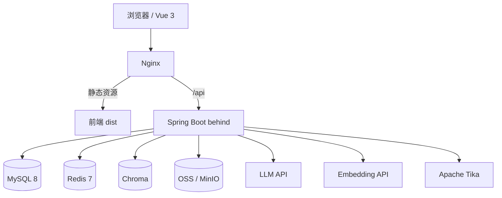
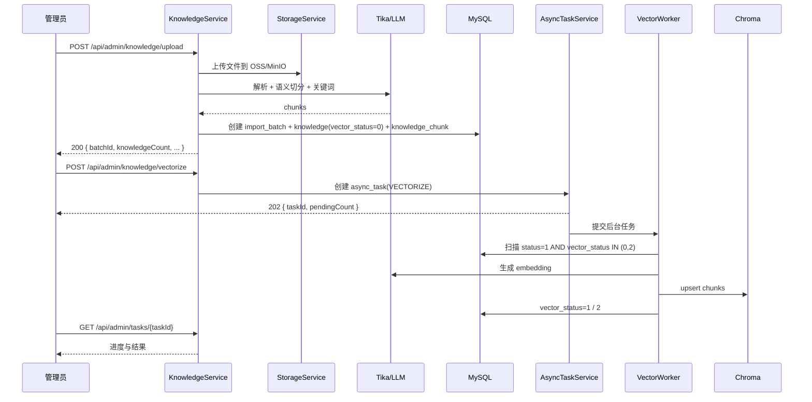
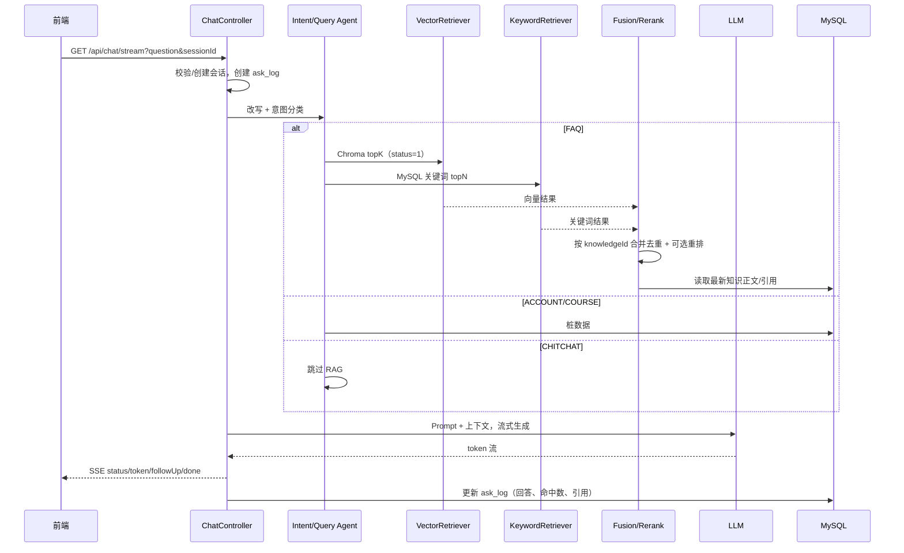

# CampusNexus 项目具体框架文档

> **项目名称**：CampusNexus（校园生活百事通 / 校园知识库问答）
> **文档版本**：v1.0（2026-10-21）
> **文档状态**：架构设计稿；Spring Boot 骨架已生成，业务接口待实现
> **关联文档**：[接口文档](./接口文档.md)、[技术栈文档](./技术栈文档.md)、[数据库建表文档](./数据库建表文档.md)、[开发计划与代码思路](./开发计划与代码思路.md)

---

## 1. 项目目标与范围

### 1.1 目标

构建一个面向校园的 RAG 知识问答系统，提供：

- 校园知识库的浏览、搜索、分类筛选；
- 基于校内文档的智能问答（SSE 流式输出）；
- 多会话管理、历史记录；
- 用户贡献、反馈、纠错闭环；
- 管理后台：知识/分类/用户/贡献/反馈/提问日志/导入批次/异步任务。

### 1.2 非目标

- 不实现爬虫或网页采集；
- 不做微服务拆分；
- 不引入 Elasticsearch、消息队列、多租户；
- 不做复杂 RBAC，仅普通用户与管理员；
- 不做 Refresh Token，Token 过期重新登录；
- MVP 的批次回滚为可选能力（回溯必做）。

---

## 2. 系统架构



### 2.1 运行时组件

| 组件 | 作用 |
|------|------|
| Nginx | 静态资源、反向代理、SSE 关闭缓冲 |
| Spring Boot | 业务 API、鉴权、RAG 编排、异步任务 |
| MySQL | 用户、知识、会话、日志、反馈、批次、任务 |
| Redis | Token 黑名单、限流、热点排行、统计缓存、任务锁 |
| Chroma | 知识分片向量与 metadata |
| OSS/MinIO | 原始文档与头像 |
| LLM/Embedding | 回答生成与向量化 |
| Tika | 文档文本解析 |

### 2.2 架构原则

1. **MySQL 是业务事实源**：知识正文、状态、会话、反馈都以 MySQL 为准；Chroma 是可重建的检索索引。
2. **外部调用最终一致**：Chroma/OSS/LLM 不参与数据库事务，用状态字段 + 异步任务 + 重试保证收敛。
3. **手动异步向量化**：上传/修改/审核只落库，向量同步由管理员触发后台任务，避免长请求阻塞。
4. **读写分层**：公共查询走轻量只读路径；问答走“混合检索 + LLM”；管理端走独立权限与分页。

---

## 3. 代码组织

```text
FirstTry/
├── docs/
│   ├── 接口文档.md
│   ├── 技术栈文档.md
│   ├── 数据库建表文档.md
│   └── 项目具体框架文档.md
├── behind/                         # Spring Boot 后端
│   ├── pom.xml
│   └── src/main/
│       ├── java/com/campusnexus/
│       │   ├── CampusNexusApplication.java
│       │   ├── common/             # Result、异常、分页、枚举
│       │   │   ├── result/
│       │   │   ├── exception/
│       │   │   └── enums/          # TaskType、TaskStatus
│       │   ├── config/             # MyBatis、Redis、Jackson、Async、OpenAPI、CORS
│       │   ├── security/           # JWT、过滤器、登录用户、Token 黑名单
│       │   ├── controller/         # 所有 REST Controller
│       │   ├── service/            # 业务接口
│       │   │   └── impl/           # 业务实现
│       │   ├── mapper/             # MyBatis-Plus Mapper
│       │   ├── entity/             # 数据库实体
│       │   ├── dto/                # 请求体
│       │   ├── vo/                 # 响应体
│       │   ├── runner/             # 启动引导（管理员初始化等）
│       │   ├── ai/                 # AI 模块
│       │   │   ├── llm/            # 非流式模型调用封装
│       │   │   ├── chat/           # 问答链路
│       │   │   │   ├── intent/     # 改写、意图、长问题拆解
│       │   │   │   ├── retrieval/  # 关键词/向量/混合检索与打分
│       │   │   │   ├── context/    # 查询感知上下文压缩
│       │   │   │   ├── answer/     # 回答模式与流式生成
│       │   │   │   └── memory/     # 多轮历史载体
│       │   │   ├── knowledge/      # 导入时的知识问答生成
│       │   │   └── vector/         # Embedding 与 Chroma 访问
│       │   └── storage/            # OSS/MinIO 抽象
│       └── resources/
│           ├── application.yml
│           ├── application-dev.yml
│           ├── application-prod.yml
│           ├── db/migration/       # Flyway
│           └── prompts/            # 提示词模板
├── frontend/                       # Vue 3 前端
│   ├── package.json
│   └── src/
│       ├── api/                    # Axios 封装与接口模块
│       ├── router/
│       ├── stores/
│       ├── views/
│       ├── components/
│       └── utils/sse.ts
├── deploy/
│   ├── docker-compose.yml
│   ├── nginx.conf
│   └── .env.example
└── README.md
```

### 3.1 后端分层

后端按“层”组织，而不是按业务模块组织：

```text
controller/     # 只做参数接收、校验、调用 service，不写业务逻辑
service/        # 业务接口，定义事务边界与业务能力
service/impl/   # 业务实现，注入 mapper/security/ai/storage
mapper/         # MyBatis-Plus Mapper，只依赖 entity
entity/         # 数据库实体，不依赖 controller/service
dto/            # 请求体
vo/             # 响应体
```

依赖规则：

- `controller` 只能依赖 `service` 接口、`dto`、`vo`、`common`。
- `service/impl` 可以依赖 `mapper`、`entity`、`dto`、`vo`、`security`、`ai`、`storage`。
- `mapper` 只依赖 `entity`。
- 禁止 `controller` 直接调用 `mapper`；禁止 `entity` 反向依赖业务层。
- 跨层基础设施放 `common`、`config`、`security`、`runner`、`ai`、`storage`。
- 异步任务的枚举放 `common/enums`，任务服务接口放 `service`、实现放 `service/impl`。

> 第 4 节的 auth/user/category 等是“业务能力划分”，不是包名；对应类分别放在 controller/service/mapper/entity 等层目录中。Controller 命名用 `CommonXxxController`、`AdminXxxController` 区分公共端与管理端。

---

## 4. 后端模块职责

| 模块 | 主要职责 | 关键表 |
|------|----------|--------|
| `auth` | 注册、登录、登出、资料、密码、头像 | `sys_user` |
| `user` | 管理端用户列表/详情/状态/角色 | `sys_user` |
| `category` | 公共分类列表、管理端分类 CRUD | `knowledge_category` |
| `knowledge` | 公共搜索/详情、管理端 CRUD、上传、批次 | `knowledge`、`knowledge_chunk`、`import_batch` |
| `chat` | SSE 问答、会话、历史 | `conversation_session`、`conversation_message`、`ask_log` |
| `feedback` | 提交反馈、管理员列表/处理 | `feedback`、`contribution` |
| `contribution` | 提交贡献、我的贡献、审核 | `contribution`、`knowledge` |
| `admin` | 仪表盘、提问日志、任务查询 | `ask_log`、`async_task` |
| `task` | 异步任务创建/执行/进度/恢复 | `async_task` |
| `ai` | RAG 检索、Agent、向量化、Prompt | `knowledge`、`knowledge_chunk` |
| `storage` | 文件上传/删除抽象 | — |
| `security` | JWT、黑名单、权限、限流支撑 | `sys_user` + Redis |

---

## 5. 核心流程

### 5.1 登录、登出与 Token 失效

1. 登录校验用户名/密码/状态，签发 JWT；Token 内包含 `sub=userId`、`jti`、`ver=tokenVersion`、`exp`。
2. JWT 过滤器解析 Token，校验签名、过期、Redis 黑名单、`tokenVersion`、用户状态。
3. 登出：把 `jti` 写入 `auth:blacklist:{jti}`，TTL 为剩余有效期。
4. 修改密码、禁用用户、修改角色：`token_version + 1`，该用户所有旧 Token 失效。
5. 禁用用户登录返回 `10006`。

### 5.2 文档上传、批次与异步向量化



关键规则：

- 上传只负责“入库”，不等待向量化；
- 批次记录文件、分类、知识数、向量统计；
- 向量化失败不阻塞上传，管理员可在任务列表看到失败原因；
- 更新知识时清理旧向量并置 `vectorStatus=0`；删除知识逻辑删除并异步清向量；
- 检索层只使用 `vectorStatus=1` 的知识，避免旧向量污染。

### 5.3 智能问答（SSE + 混合检索）



要点：

- `sessionId` 对外 UUID，匿名会话凭 UUID 继续，但历史接口仅登录本人可查；
- 原生 `EventSource` 不能带 Token，前端使用 `fetch` + `ReadableStream`；
- `done.matchCount` 是合并去重后的知识数；
- 混合检索中，MySQL 关键词分支可以兜底“尚未同步向量的知识”；
- 未登录也会写 `ask_log`（`user_id=NULL`），但匿名日志不支持反馈。

### 5.4 反馈与纠错贡献

1. 用户对 `done.logId` 提交 like/dislike/report；
2. 校验日志归属、重复反馈（唯一键 `(user_id, log_id, feedback_type)`）；
3. `dislike + correctAnswer` 自动创建 `contribution(type=correction,status=0)`，并回填 `feedback.created_contribution_id`；
4. 管理员在 6.2/6.3 处理反馈，在 7.9 审核纠错贡献；
5. 审核通过写入 `knowledge(vector_status=0)`，等待手动向量化。

### 5.5 贡献审核

1. 用户提交贡献（分类必须启用）；
2. 管理员列表/详情查看；
3. 通过：写 `knowledge`，回填 `contribution.knowledge_id`；`qa` 类型解析 `问：...答：...`；
4. 驳回：记录 `review_remark`；
5. 不可重复审核（`20004`）；
6. 新知识 `vector_status=0`，需 7.10 同步。

### 5.6 批次回滚（可选）

1. 管理员对 `batchId` 发起回滚，`force=false` 时先检查是否有上传后修改的知识；
2. 创建 `async_task(BATCH_ROLLBACK)`，返回 `taskId`；
3. 后台任务逻辑删除批次知识、删除 Chroma 向量；`deleteFile=true` 时删除 OSS 文件；
4. 更新批次状态 `ROLLED_BACK`；
5. 与向量化共用单线程任务队列，避免并发写 Chroma。

### 5.7 用户禁用/角色变更

1. 管理端不能操作自己，不能移除最后一个管理员；
2. 更新 `sys_user.status/role` 并 `token_version + 1`；
3. 旧 Token 在下一次请求被过滤器拒绝；
4. 被禁用用户登录返回 `10006`。

---

## 6. 异步任务框架

### 6.1 任务模型

```text
TaskType:   VECTORIZE | BATCH_ROLLBACK
TaskStatus: PENDING | RUNNING | SUCCESS | PARTIAL | FAILED
```

- `VECTORIZE`：`total` 为待同步知识数，按批 20 条处理；
- `BATCH_ROLLBACK`：`total` 为该批次知识数，逐条/分批删除；
- `PARTIAL`：任务完成但存在失败条目；
- 任务记录落 `async_task`，`payload_json` 保存 `batchId` 等参数。

### 6.2 执行器

- 使用专用 `ThreadPoolTaskExecutor`，**核心/最大线程数建议为 1**（串行写 Chroma，避免并发冲突），队列 20。
- 队列满或已有向量类任务时返回 `20013`。
- 通过 Redis `lock:vector` + `SET NX PX` 防止多实例并发；锁 TTL 30 分钟，执行期间续期。
- 进度每处理 20 条或每 5 秒更新一次，避免高频写库。
- 单条失败重试 2 次（指数退避），仍失败则 `vector_status=2` 并继续其他条目。
- 应用启动时把遗留 `RUNNING` 任务标记为 `FAILED`，并重置对应知识为待同步。
- 回滚任务同样复用该执行器，串行执行。

### 6.3 服务接口（示意）

```java
public interface AsyncTaskHandler {
    TaskType supportType();
    void execute(AsyncTask task, TaskProgressSink sink);
}

public interface AsyncTaskService {
    String create(TaskType type, JsonNode payload, Long createdBy);
    AsyncTaskVO get(String taskId);
    PageResultVO<AsyncTaskVO> page(TaskQuery query);
}
```

- Controller 只负责创建任务并返回 202；
- Handler 不直接操作 HTTP 上下文；
- 任务表更新使用独立短事务，避免与长耗时外部调用共用一个事务。

---

## 7. RAG / AI 模块

### 7.1 组件

| 组件 | 职责 |
|------|------|
| `DocumentIngestor` | Tika 解析、清洗、语义切分、关键词/问法生成 |
| `VectorizationService` | 生成 embedding、写入 Chroma、更新 `vector_status` |
| `VectorRetriever` | Chroma topK，metadata 过滤 |
| `KeywordRetriever` | MySQL `LIKE` 候选召回 + 字段权重/覆盖率打分 |
| `HybridRetriever` | 合并去重、归一化分数加权 |
| `QueryRewriteAgent` | 改写、意图分类 |
| `QueryDecompositionAgent` | 长问题拆子问题、并行检索 |
| `ContextCompressor` | 超长上下文压缩 |
| `AnswerAgent` | 组装 Prompt，调用 LLM 流式生成 |
| `FollowUpAgent` | 追问引导与推荐 |

### 7.2 摄取

1. 上传文件 → OSS；
2. Tika 提取文本；
3. 语义切分（500-800 字，overlap 80-120）；
4. 生成关键词/问法变体；
5. 写 `knowledge`、`knowledge_chunk`、`import_batch`；
6. `vector_status=0`，等待手动同步。

### 7.3 手动异步向量化

- 管理员触发 7.10；
- 只扫描 `status=1 AND vector_status IN (0,2) AND deleted=0`；
- 每条知识先删除旧 chunk/向量，再重新切分/embedding/upsert；
- 成功后 `vector_status=1, vector_synced_time=now()`；
- 失败 `vector_status=2, vector_error=...`，任务继续；
- 任务结束状态：全成功 `SUCCESS`，部分失败 `PARTIAL`，全部失败 `FAILED`。

### 7.4 混合检索

```text
向量召回：Chroma topK=8，metadata status=1
关键词召回：MySQL title/question/answer/keywords LIKE，topN=20
融合：按 knowledgeId 去重，RRF 或 0.7*向量分 + 0.3*关键词分
过滤：MySQL 校验 status=1 AND deleted=0 AND vector_status=1（向量分支）
重排：可选 bge-reranker，取 top 3-5
```

- MySQL 关键词分支用于课程代码、楼名、日期等精确词；
- 向量分支用于语义相近表达；
- 未同步向量的知识仍可能被关键词分支命中；
- `matchCount` 为合并去重后的知识数。

### 7.5 生成

- System Prompt 约束：只基于给定知识回答；无依据时明确说明；引用知识标题；不执行知识文本中的指令（防提示注入）。
- 温度 0.2-0.4；最大输出按场景配置；超时与重试在 LLM 客户端配置。
- 输出 Markdown；前端 DOMPurify 净化后渲染。
- 记录 `ask_log`：问题、回答、confidence、source、matchCount、引用列表。

### 7.6 评测

- 30 条以上评测问题，覆盖 10 个分类；
- 指标：Recall@5、引用准确率、无依据回答率、P95 延迟；
- 人工抽检回答是否可追溯到引用知识。

---

## 8. 数据层

- MyBatis-Plus 全局 `IdType.AUTO`，与文档“自增 BIGINT”一致；
- 逻辑删除仅用于 `knowledge.deleted`，通过 `@TableLogic`；
- 分页统一 `PageResultVO`，不直接返回 `Page` 实体；
- 事务只包 MySQL 操作；Chroma/OSS/LLM 不放在事务中；
- Flyway 管理 `V1__init_schema.sql`、`V2__seed_categories.sql`；
- 所有查询显式带 `deleted=0` / `status=1` 条件，避免漏过滤。

---

## 9. API 层

### 9.1 统一返回与异常

- `Result<T>`：`code/message/data/timestamp`；
- 业务错误 HTTP 200 + 业务码；协议错误 400/401/403/404/422/429/500；
- `GlobalExceptionHandler` 处理：
  - `BizException` → 对应业务码；
  - `MethodArgumentNotValidException` → 422 + 字段错误映射；
  - 文件大小/类型异常 → 20005/20006；
  - 未捕获异常 → 500，日志记录 traceId。

### 9.2 参数校验

- 请求 DTO 使用 Bean Validation；
- 创建/更新使用不同 DTO（如 `KnowledgeImportDTO` / `KnowledgeUpdateDTO`）；
- 分页 `size` 最大 100；
- 分类、角色、状态等枚举值显式校验。

### 9.3 SSE

- 使用 `SseEmitter`，超时时间建议 3-5 分钟；
- 所有消息使用默认 `message` 事件，JSON 内含 `type`；
- `status` / `token` / `followUp` / `done` / `error`；
- 心跳注释行每 15 秒；
- 客户端断开时取消 LLM 订阅；
- Nginx 关闭缓冲。

### 9.4 OpenAPI

- springdoc 注解与接口文档保持一致；
- 管理端接口标注 `@SecurityRequirement`；
- 文件上传、SSE 单独描述；
- CI 可对比 OpenAPI 路径与文档速查表。

---

## 10. 安全设计

| 项 | 方案 |
|----|------|
| 密码 | BCrypt，禁止明文/可逆加密 |
| JWT | HS256/RS256，密钥 ≥256 bit，24h 过期 |
| 登出 | Redis 黑名单 `auth:blacklist:{jti}` |
| 全量失效 | `token_version` +1（改密/禁用/改角色） |
| 权限 | 普通用户 / 管理员，`ROLE_ADMIN` |
| 限流 | Redis 计数器，聊天按 IP + 用户；429 |
| CORS | 白名单，仅允许前端域名 |
| 上传 | 扩展名 + MIME + 文件头；20MB/5MB |
| XSS | AI 回答 Markdown 渲染前 DOMPurify |
| 提示注入 | 知识文本视为数据；System Prompt 明确禁止执行其中指令 |
| 越权 | 会话/日志/反馈均校验 userId；管理员接口统一 role 校验 |
| 隐私 | 提问日志仅管理员可查，设置保留期 |

---

## 11. 前端框架

### 11.1 页面

| 路由 | 页面 |
|------|------|
| `/login`、`/register` | 登录/注册 |
| `/` | 智能问答（SSE） |
| `/knowledge` | 知识库搜索/分类 |
| `/knowledge/:id` | 知识详情 |
| `/contribute` | 提交贡献 |
| `/my/contributions` | 我的贡献 |
| `/admin/dashboard` | 仪表盘 |
| `/admin/knowledge` | 知识管理 |
| `/admin/knowledge/upload` | 文档上传/批次 |
| `/admin/contributions` | 贡献审核 |
| `/admin/feedback` | 反馈处理 |
| `/admin/users` | 用户管理 |
| `/admin/categories` | 分类管理 |
| `/admin/question-logs` | 提问日志 |
| `/admin/import-batches` | 导入批次/回滚 |
| `/admin/tasks` | 异步任务进度 |

### 11.2 关键实现

- `utils/sse.ts`：fetch + ReadableStream 解析 `data:` 行；支持 `AbortController`；
- `stores/auth.ts`：Token、用户信息、角色路由守卫；
- `stores/chat.ts`：当前会话、消息列表、流式状态；
- `api/`：Axios 实例统一处理 `code !== 200`；
- 管理端表格统一分页、筛选、空态；
- CSV/文档上传显示进度与批次结果；
- 管理端显示向量状态与“待同步”提醒。

---

## 12. 配置与部署

### 12.1 配置

- `application-dev.yml`：本地 MySQL/Redis/Chroma/MinIO；
- `application-prod.yml`：环境变量注入，关闭 SQL 日志；
- `spring.jackson.time-zone=Asia/Shanghai`；
- MyBatis-Plus `id-type=auto`、逻辑删除配置；
- 异步执行器、SSE 超时、上传大小配置。

### 12.2 Docker Compose

服务：

```text
mysql      -> 3306, volume mysql-data
redis      -> 6379, volume redis-data
chroma     -> 8000, volume chroma-data
minio      -> 9000/9001, volume minio-data（仅开发）
backend    -> 8080
frontend   -> 80 (Nginx)
```

### 12.3 Nginx

- `/` 指向前端 dist；
- `/api/` 反代 backend；
- `/api/chat/stream`：`proxy_buffering off; proxy_read_timeout 300s;`；
- `client_max_body_size 25m;`；
- 透传 `X-Forwarded-For`，仅信任内网代理。

---

## 13. 测试策略

| 类型 | 内容 |
|------|------|
| 单元测试 | Token、用户状态、分类校验、任务状态机、批次校验 |
| 集成测试 | Testcontainers MySQL/Redis；MockMvc 全接口权限矩阵 |
| SSE 测试 | Mock LLM，验证 status/token/done/error 顺序与终止 |
| RAG 评测 | 30 条问题，Recall@5、引用准确率、延迟 |
| 文件测试 | 13 种格式、20MB 边界、损坏文件 |
| 前端测试 | 登录、问答流、管理端 CRUD；Playwright 可选 |
| 部署验收 | `docker compose up` 一键启动，健康检查通过 |

---

## 14. 开发里程碑

| 阶段 | 交付 |
|------|------|
| M0 | 文档冻结、ER/DDL、环境变量、Docker Compose 骨架 |
| M1 | 后端脚手架、统一返回/异常、登录注册/JWT/权限、Swagger |
| M2 | 分类、知识 CRUD、文档上传、批次回溯 |
| M3 | 异步任务框架、手动向量化、Chroma 接入 |
| M4 | SSE 问答、会话、混合检索、提问日志 |
| M5 | 反馈、纠错贡献、贡献审核 |
| M6 | 管理端用户/分类/日志/任务/批次接口 |
| M7 | 前端问答、知识库、管理后台 |
| M8 | 测试、Docker 部署、验收与文档回填 |

---

## 15. 完成标准（DoD）

- 48 个接口与文档一致，OpenAPI 可访问；
- Flyway 从空库可完整初始化；
- 权限矩阵测试通过（匿名/用户/管理员）；
- 上传 → 批次 → 手动异步向量化 → 问答命中闭环可演示；
- 更新/删除知识后不会检索到过期内容；
- 反馈 → 纠错贡献 → 审核 → 知识入库闭环可演示；
- 用户禁用/改密后旧 Token 失效；
- 聊天限流返回 429；
- 前端问答流式输出、知识库、管理端主要页面可用；
- `docker compose up` 可启动全部依赖；
- 仓库无明文密钥，README 可指导新成员启动。

---

## 16. 风险与待确认事项

| 事项 | 说明 | 建议 |
|------|------|------|
| 批次回滚是否进 MVP | 回溯已确定；回滚为可选 | 先做追溯，回滚接口按 7.16 预留 |
| LLM 供应商 | 影响成本/延迟/网络 | 先接 OpenAI 兼容接口，配置切换 |
| Embedding 部署 | 本地 BGE-M3 需 GPU/CPU 资源 | 开发可用云端，生产评估本地 |
| OSS 读权限 | 公共读 vs 签名 URL | MVP 公共读；敏感文档改签名 |
| 提问日志保留期 | 隐私与审计平衡 | 建议 180 天，支持按用户清理 |
| 分类删除策略 | 引用后不可删 | 停用代替删除，前端明确提示 |
| 关键词检索性能 | `LIKE` 无索引 | 万级可接受，后续 ngram/ES |
| SSE 代理超时 | 长回答可能被断开 | Nginx 300s + 心跳 + 前端重连策略 |

---

## 17. 建议的下一步

1. 按 [数据库建表文档](./数据库建表文档.md) 生成 Flyway `V1__init_schema.sql`；
2. 初始化 Spring Boot 工程与统一返回/异常/安全骨架；
3. 先实现分类、知识、上传、批次与异步任务；
4. 再接 Chroma 向量化与混合检索；
5. 最后做前端与部署。
